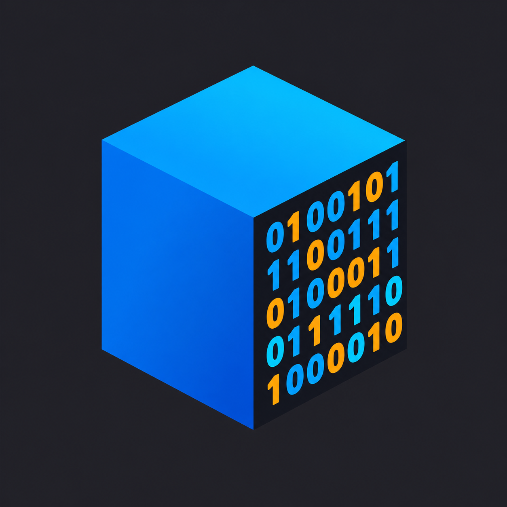
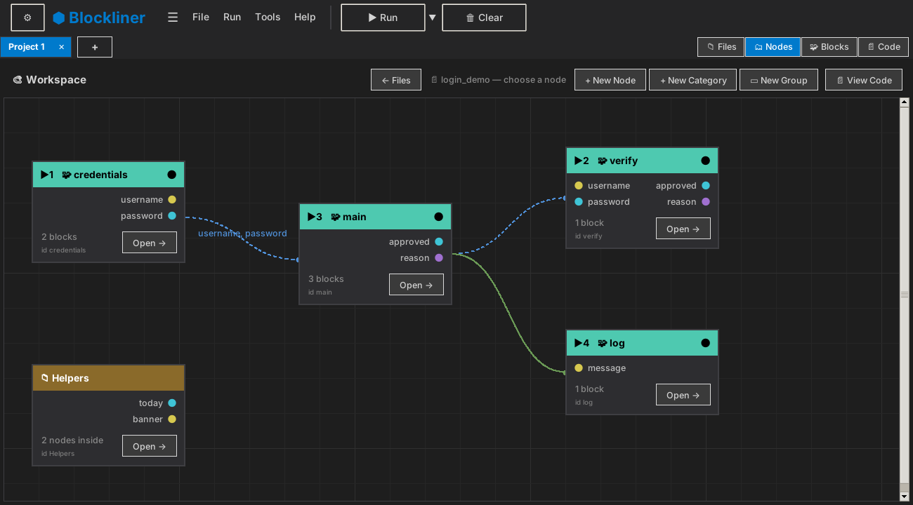
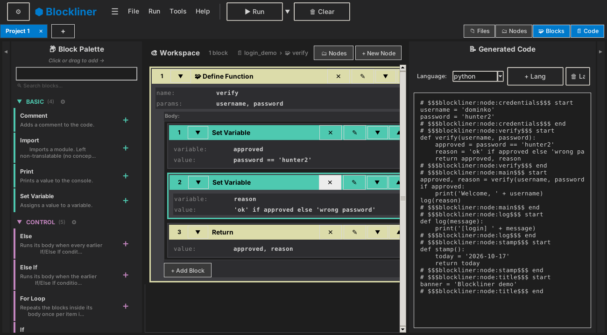

<p align="center">
  
</p>

<h1 align="center">Blockliner</h1>

<p align="center">
  <b>A block-based and node-based visual programming editor that generates real source code.</b><br>
  Build programs from blocks, nodes and wires; get readable Python, C, C++, C#, Java, JavaScript, Rust, Go or HTML out.
  A desktop app for Linux, Windows and macOS.
</p>

<p align="center">
  <a href="https://github.com/somore100/Blockliner/releases"></a>
  
  
  
  
  <a href="LICENSE.md"></a>
</p>

<p align="center">
  <a href="#screenshots">Screenshots</a> ·
  <a href="#download">Download</a> ·
  <a href="#quick-start">Quick start</a> ·
  <a href="#how-it-works">How it works</a> ·
  <a href="#supported-languages">Languages</a> ·
  <a href="#status">Status</a> ·
  <a href="#roadmap">Roadmap</a> ·
  <a href="#license">License</a>
</p>

---

Blockliner is a desktop app (Python + Tkinter) for people who want the structure of **visual programming** without giving up **real code**. You assemble logic from blocks, group it into **nodes**, and connect nodes with **wires**. Blockliner generates ordinary, properly formatted source files, and you can read, edit and export that code at any time.

It exists to fix one problem: **remembering exact syntax**. Most block tools are made for teaching and stop at small programs. Blockliner is aimed at real projects: many files, many languages, and a way out to plain code whenever you want one.

## What it is, and what it isn't

- It **is** a visual layer on top of real programming languages: every block and node becomes ordinary source code that you own and can edit by hand.
- It is **not** a no-code app builder. Nothing is hidden or locked; you still write programs, you just stop retyping syntax.
- It is **not** a teaching toy. Tools like Scratch are built for learning and run programs in their own player; Blockliner outputs plain source files in the language you pick.
- It is **not** a web or Electron app. It is a small Python/Tkinter desktop program.

## Screenshots

**Nodes layer**: every function is a node. Wires and ports are drawn from your code.

<p align="center">
  
</p>

**Blocks layer**: edit one node as blocks, with the generated code beside it.

<p align="center">
  
</p>

## Why Blockliner

- **Real code, always visible.** Blocks never hide the output: the generated source is one click away, and editing it syncs back to the blocks.
- **Not a dead end.** Anything the block library can't express stays as a *Raw Code* block, so you are never stuck.
- **Built for more than one file.** Projects have files, files have nodes, nodes have blocks.
- **Nine languages from one editor**, defined by plain JSON language packs you can extend.
- **Wires are derived, never stored.** The graph and the code can't drift apart. See [How it works](#how-it-works).

## Who it's for

| You are | What you get |
|---|---|
| **Learning to code** | Concepts without the syntax errors, and the real code to read next to your blocks |
| **An intermediate developer** | Less repetitive typing, the same logic in nine languages |
| **An advanced developer** | Reusable node templates, custom blocks and language packs, and a code panel that never locks you out |

## Download

Prebuilt binaries (Windows `.exe`, Linux `.AppImage`, macOS binary) are attached to each version on the
**[Releases page](https://github.com/somore100/Blockliner/releases)** once the automated build for that version has finished.
If there is no download for your system yet, [run it from source](#quick-start); it takes a few minutes.

## Quick start

You need **Python 3.11+** and **tkinter**. Tkinter is bundled with the python.org installers on Windows and macOS; on Linux it is a separate package that the setup script installs for you. With a Homebrew Python on macOS, install the matching `python-tk` package first.

**Linux / macOS**

```bash
git clone https://github.com/somore100/Blockliner.git
cd Blockliner
./setup_venv.sh
venv/bin/python main.py
```

**Windows (PowerShell)**

```powershell
git clone https://github.com/somore100/Blockliner.git
cd Blockliner
python -m venv venv
venv\Scripts\pip install -r requirements.txt
venv\Scripts\python main.py
```

Your first five minutes: pick a language, add a **Print** block from the palette, press **Run** (Python runs inside the app), then switch the language and watch the same blocks produce different code.

## How it works

Blockliner has four layers, switched from the bar at the top right. Each one is a closer look at the same project:

| Layer | What you see |
|---|---|
| **Files** | The files in your project and how they import each other |
| **Nodes** | The nodes of one file as a canvas of boxes and wires |
| **Blocks** | The blocks inside one node (drag from the palette) |
| **Code** | The generated source, editable, synced back to the blocks |

**Nodes and wires.** A node is a part of your program: usually a function, or a group of statements. Calls between nodes appear as wires automatically; dragging a wire between two nodes writes the call for you. Delete the wire and the call goes with it. Wires come in three kinds, all derived from the code:

| Wire | Meaning | Look |
|---|---|---|
| **Call** | one node runs another | solid green |
| **Data** | a node uses another node's result, or reads a variable it sets | dashed blue |
| **Import** | one file imports another | dotted violet |

**Ports.** A node's public interface is shown as coloured dots. A function's parameters are its inputs; its returned values are its outputs. A node with no function offers the variables it assigns as outputs. Drag an output onto another node or onto one of its inputs to wire them together. A **category** shows on its edge every output of the nodes inside it that nothing inside uses.

**Organising.** Nodes have a visible run order. You can *Ignore* a node (leave it out of the output) or *Skip* it (bypass it: its code and every call to it appear as `##` comments). **Categories** open like folders; **groups** are labelled coloured regions on the canvas. **Node templates** let you save a node and reuse it.

**Code in, code out.** Export real source files. Edit the generated code and the blocks follow. Import an existing file: Blockliner recognises what it can and keeps the rest as editable raw code. In Python, typing an expression into a block's slot converts recognised patterns (such as a function call) into structured sub-blocks, and leaves anything else as plain text.

## Supported languages

| Language | Generates code | Runs inside the app |
|---|:---:|:---:|
| Python | ✅ | ✅ |
| JavaScript | ✅ | |
| C | ✅ | |
| C++ | ✅ | |
| C# | ✅ | |
| Java | ✅ | |
| Rust | ✅ | |
| Go | ✅ | |
| HTML | ✅ | |

Each language is a folder of JSON files under `languages/` (one file per block), so adding a language or a block means adding files, not changing the program. There is also a custom block builder inside the app. Smart slots currently work for Python only.

## Status

**Beta (version 2.x).** The core is built and used daily by its author: you can build, wire, save, reopen and export projects in all nine languages. Beta here means:

- It is developed and tested mainly on **Linux**. Windows and macOS builds exist but have had much less real-world use.
- Some newer features have only been tested automatically (a headless UI test suite of 50+ files), not on every desktop.
- File formats can still change between versions. **Keep backups of projects you care about.**
- Some features are partial; see [Known limitations](#known-limitations).

## Known limitations

- Only **Python** can be run inside the app; the other languages generate code only.
- Importing existing C, C++, C# or Java code puts it inside the app's generated `main`/class wrapper, and in these languages raw code blocks lose indentation and blank lines.
- Code that Blockliner doesn't recognise stays as raw code; there is no full automatic conversion of arbitrary projects yet.
- Wires are not drawn to or from a *collapsed* category, and zoomed-out (compact) node boxes have no ports.
- The plugin/extension bar is reserved in the interface but has no API yet.

## Roadmap

**Done**

- [x] Block editor, code generation and the JSON language-pack system
- [x] Nine language packs: Python, C, C++, C#, Java, JavaScript, Rust, Go, HTML
- [x] Custom block builder
- [x] Code-to-blocks import and live sync from the code panel
- [x] Smart slots for Python (typed code snaps into structured blocks)
- [x] Node-and-wire canvas: drag-to-wire, wires derived from code, run order, zoom and pan
- [x] Ports (inputs and outputs from function parameters, returns and variables), drag a port onto a node or input
- [x] Wire kinds: call, data and import, each with its own look
- [x] Categories (with output ports), groups, Ignore and Skip, multi-select and multi-open
- [x] Node templates
- [x] Projects: save and reopen workspaces, open a whole folder
- [x] Zoom level-of-detail (compact boxes when zoomed out)
- [x] About window, top-bar menus, settings

**Next**

- [ ] Confirmed, automated release builds for Windows, macOS and Linux
- [ ] Testing and polish on Windows and macOS (the author develops on Linux)
- [ ] Wires to and from collapsed categories, and a legend for the wire kinds
- [ ] Wires between files on the Files layer, and import nodes
- [ ] Group ⇄ category conversion
- [ ] Output ports that follow the branches of a node's code (for example one port for "approved" and one for "declined")
- [ ] Settings reorganisation

**Later / ideas**

- [ ] Plugin and extension API
- [ ] Growing the library of prebuilt and custom node templates
- [ ] Full "open an existing project" conversion into nodes and blocks
- [ ] More languages able to run inside the app
- [ ] Block descriptions that show the real generated syntax
- [ ] Non-code files (Markdown, JSON, text) inside a project
- [ ] A "push to git" button
- [ ] A basic tutorial
- [ ] A web version (no mobile app is planned)

## Contributing

Ideas, bug reports and language packs are welcome: open an [issue](https://github.com/somore100/Blockliner/issues). Because Blockliner is in beta, please include your operating system and the language you were generating when you report a problem.

To run the tests:

```bash
for t in tests/test_*.py; do venv/bin/python "$t" || break; done
```

The interface tests need a display; on a headless machine run them under `xvfb-run -a`.

## License

Blockliner is **source-available**, not open source. You can read it, run it, learn from it, and modify it or fork it for non-commercial use. Making add-ons, plugins and integrations is welcome. Selling or commercially redistributing Blockliner, or a substantial part of it, needs permission from the copyright holder. See [LICENSE.md](LICENSE.md) for the full terms.

> Not a toy, and not a replacement for code: a different way to write it.
